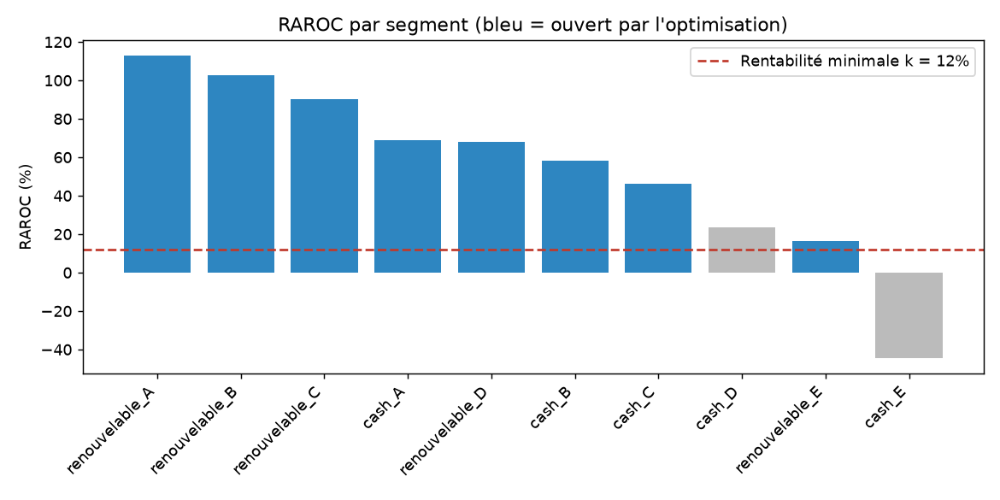
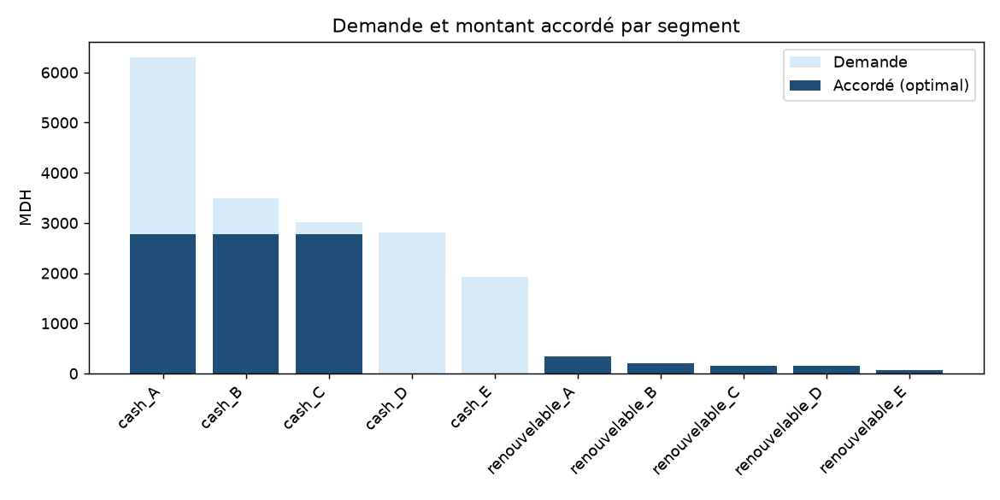
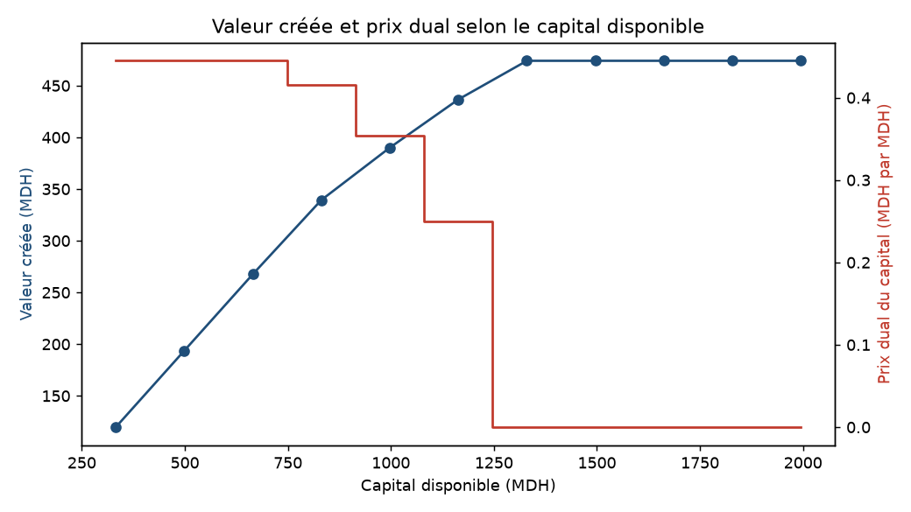

# Allocation optimale du capital par RAROC

Généré le 19/10/2026 par `optimisation/allocation_capital.py`.

## Résultat principal

- Valeur créée : **339.4 MDH**, contre 185.7 MDH pour une allocation proportionnelle à la demande (+83%).
- RAROC du portefeuille : **52.8%** (rentabilité minimale 12%).
- Production : 9,236 MDH ; capital utilisé : 831 / 831 MDH.
- Coût du risque : 1.90% (maximum 3%) ; segments ouverts : 8 / 10.
- Prix dual du capital : **0.415** MDH de valeur par MDH de capital en plus (vérification par différence finie : 0.415).
- Prix dual du coût du risque : 0.000 ; du financement : 0.000.
- Vérificateur indépendant : toutes les contraintes respectées.
- Allocation proportionnelle : ne respecte pas : C2 concentration, C3 coût du risque.

## Hypothèses

| Hypothèse | Valeur |
| --- | --- |
| LGD (O4) | 45% |
| Pondération Bâle RW (O5) | 75% |
| Ratio de capital (O6) | 12% |
| Rentabilité minimale k (O7) | 12% |
| Concentration max (O9) | 30% |
| Coût du risque max (O10) | 3% |
| Capital disponible (O11) | 50% du besoin |
| Ressources (O11) | 80% de la demande |
| Taux client (O8) | cash 12%, renouvelable 18% |
| Coût de financement (O8) | 3% |

## Allocation par segment (montants en MDH)

| segment | clients | demande | pd | taux_observe | marge_nette | perte_attendue | raroc | valeur_unitaire | ouvert | accorde_mdh | part_demande | part_production |
| --- | --- | --- | --- | --- | --- | --- | --- | --- | --- | --- | --- | --- |
| cash_A | 8 158 | 6 301.241 | 0.018 | 0.022 | 0.070 | 0.008 | 0.688 | 0.051 | 1 | 2 770.761 | 0.440 | 0.300 |
| cash_B | 5 363 | 3 487.847 | 0.039 | 0.040 | 0.070 | 0.018 | 0.581 | 0.042 | 1 | 2 770.761 | 0.794 | 0.300 |
| cash_C | 5 123 | 3 018.508 | 0.064 | 0.066 | 0.070 | 0.029 | 0.460 | 0.031 | 1 | 2 770.761 | 0.918 | 0.300 |
| cash_D | 5 208 | 2 806.802 | 0.109 | 0.112 | 0.070 | 0.049 | 0.233 | 0.010 | 0 | 0.000 | 0.000 | 0.000 |
| cash_E | 4 003 | 1 929.465 | 0.245 | 0.242 | 0.070 | 0.110 | -0.446 | -0.051 | 0 | 0.000 | 0.000 | 0.000 |
| renouvelable_A | 762 | 340.627 | 0.019 | 0.009 | 0.110 | 0.008 | 1.129 | 0.091 | 1 | 340.627 | 1.000 | 0.037 |
| renouvelable_B | 647 | 200.407 | 0.039 | 0.028 | 0.110 | 0.018 | 1.025 | 0.081 | 1 | 200.407 | 1.000 | 0.022 |
| renouvelable_C | 599 | 161.303 | 0.064 | 0.045 | 0.110 | 0.029 | 0.904 | 0.071 | 1 | 161.303 | 1.000 | 0.017 |
| renouvelable_D | 578 | 151.627 | 0.108 | 0.087 | 0.110 | 0.049 | 0.681 | 0.051 | 1 | 151.627 | 1.000 | 0.016 |
| renouvelable_E | 299 | 73.912 | 0.211 | 0.181 | 0.110 | 0.095 | 0.165 | 0.004 | 1 | 69.622 | 0.942 | 0.008 |

## Comparaison avec l'allocation proportionnelle

|  | Optimisation (PLNE) | Proportionnelle |
| --- | --- | --- |
| production_mdh | 9 235.870 | 9 235.870 |
| capital_utilise_mdh | 831.228 | 831.228 |
| resultat_ajuste_mdh | 439.105 | 285.424 |
| valeur_creee_mdh | 339.357 | 185.677 |
| raroc_portefeuille | 0.528 | 0.343 |
| cout_risque | 0.019 | 0.031 |
| segments_ouverts | 8.000 | 10.000 |

## Sensibilité au capital disponible

| capital_pct_besoin | capital_mdh | valeur_creee_mdh | dual_capital | production_mdh | segments_ouverts |
| --- | --- | --- | --- | --- | --- |
| 20 | 332.491 | 119.743 | 0.445 | 3 694.348 | 7 |
| 30 | 498.737 | 193.687 | 0.445 | 5 541.522 | 7 |
| 40 | 664.983 | 267.630 | 0.445 | 7 388.696 | 7 |
| 50 | 831.228 | 339.357 | 0.415 | 9 235.870 | 8 |
| 60 | 997.474 | 390.034 | 0.354 | 11 083.044 | 8 |
| 70 | 1 163.720 | 436.640 | 0.250 | 12 930.218 | 8 |
| 80 | 1 329.965 | 474.013 | 0.000 | 14 630.049 | 9 |
| 90 | 1 496.211 | 474.013 | 0.000 | 14 630.049 | 9 |
| 100 | 1 662.457 | 474.013 | 0.000 | 14 630.049 | 9 |
| 110 | 1 828.702 | 474.013 | 0.000 | 14 630.049 | 9 |
| 120 | 1 994.948 | 474.013 | 0.000 | 14 630.049 | 9 |

## Scénarios de stress

| scenario | valeur_reoptimisee_mdh | production_mdh | raroc_portefeuille | segments_ouverts | dual_capital | valeur_allocation_base_mdh | allocation_base_respecte |
| --- | --- | --- | --- | --- | --- | --- | --- |
| Base | 339.357 | 9 235.870 | 0.528 | 8 | 0.415 | 339.357 | oui |
| PD x 1,5 | 251.521 | 9 235.870 | 0.423 | 8 | 0.272 | 251.521 | oui |
| Capital -20 % | 267.630 | 7 388.696 | 0.522 | 7 | 0.445 | 339.357 | non : C1 capital |
| Financement +2 pts | 154.640 | 9 235.870 | 0.306 | 8 | 0.193 | 154.640 | oui |
| Sévère (les trois) | 52.041 | 7 388.696 | 0.198 | 7 | 0.116 | 66.804 | non : C1 capital |

## Graphiques

